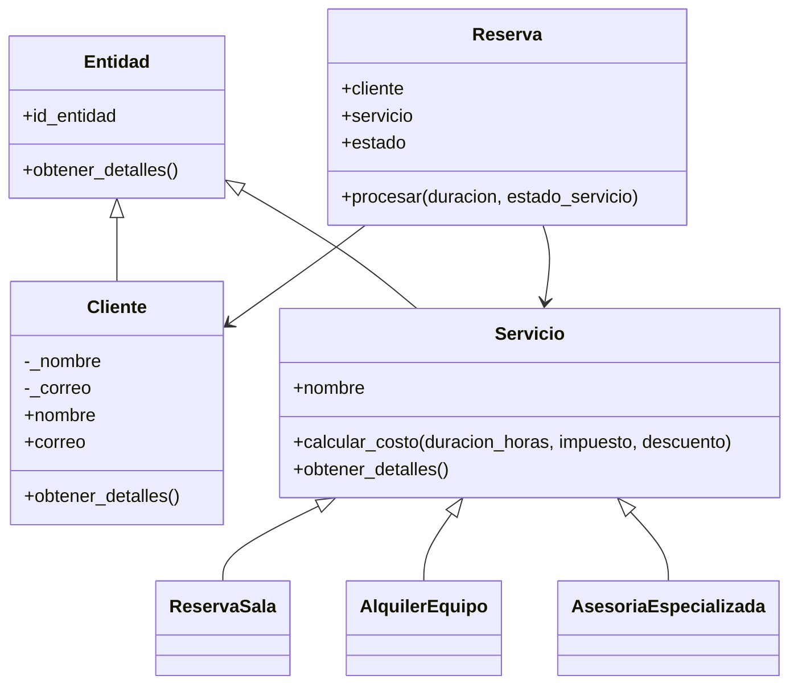

# Sistema Integral de Gestión - Software FJ

**Universidad Nacional Abierta y a Distancia (UNAD)**
**Curso:** Programación (213023) · **Grupo:** 213023A_2204
**Fase:** 4 - Prácticas Simuladas
**Programa:** Ingeniería de Sistemas

## 📝 Descripción del Proyecto
Este proyecto consiste en el desarrollo de un sistema integral orientado a objetos (sin uso de bases de datos) para la empresa **Software FJ**. El sistema gestiona clientes, servicios (reservas de salas, alquiler de equipos y asesorías) y reservas, garantizando estabilidad, modularidad y un manejo robusto de errores: ningún dato inválido ni fallo simulado detiene el programa, y todo queda registrado en un archivo de log.

## 🚀 Características Implementadas
*   **Programación Orientada a Objetos (POO):**
    *   **Abstracción:** Uso de clases abstractas (`Entidad`, `Servicio`).
    *   **Herencia:** Clases derivadas como `Cliente`, `ReservaSala`, `AlquilerEquipo` y `AsesoriaEspecializada`.
    *   **Polimorfismo:** Sobrescritura del método `calcular_costo` en cada tipo de servicio.
    *   **Encapsulación:** Validación estricta de datos en la clase `Cliente` mediante `@property` (nombre y formato de correo).
*   **Manejo Avanzado de Excepciones:**
    *   Excepciones personalizadas: `ErrorValidacion` y `ServicioNoDisponible`.
    *   Uso completo de bloques `try`, `except`, `else`, `finally`.
    *   **Encadenamiento de excepciones** (`raise ... from ...`) para rastrear fallos de red.
*   **Registro de Eventos (Logging):** Todos los eventos, errores y transacciones se registran automáticamente en el archivo `sistema_fj.log` (ver sección [Archivo de logs](#-archivo-de-logs)).
*   **Menú interactivo:** Permite registrar reservas con datos ingresados por el usuario y simular caídas del servicio.

## 🗂️ Estructura del Repositorio
```
Fase_Programacion_213023A_2204/
├── sistema_fj.py     # Código fuente completo del sistema
├── README.md         # Documentación del proyecto (este archivo)
├── .gitignore        # Evita subir al repositorio los archivos de log y temporales
└── sistema_fj.log    # Se crea automáticamente al ejecutar el programa (no se sube a GitHub)
```

## 🧩 Diagrama de Clases


## ⚠️ Excepciones y cómo se manejan
| Excepción | Cuándo ocurre | Dónde se captura | Nivel en el log |
|---|---|---|---|
| `ErrorValidacion` | Nombre vacío o muy corto, correo sin formato `usuario@dominio.com`, duración menor o igual a 0 | `Reserva.procesar()` y el menú | `ERROR` |
| `ServicioNoDisponible` | Se simula una caída de red (`ConnectionError`), encadenada con `raise ... from e` | `Reserva.procesar()` | `ERROR` (incluye la causa original) |
| `ValueError` | El usuario escribe texto donde se espera un número (ID o duración) | Menú interactivo | `WARNING` |
| Cualquier otra (`Exception`) | Error no previsto | `Reserva.procesar()` y el menú | `CRITICAL` (con la traza completa) |

## 📒 Archivo de logs
El sistema usa el módulo estándar `logging` de Python. La configuración está al inicio de `sistema_fj.py` (sección 1):

| Aspecto | Configuración | Por qué |
|---|---|---|
| Ubicación | `sistema_fj.log`, en la misma carpeta del programa | El archivo aparece en el proyecto sin importar desde qué carpeta se ejecute |
| Modo de escritura | `"a"` (añadir) | Conserva el historial de todas las sesiones; cada una se separa con `INICIO DE SESIÓN` y `FIN DE SESIÓN` |
| Rotación | `RotatingFileHandler`, 1 MB y 3 copias de respaldo | Evita que el archivo crezca sin límite (`sistema_fj.log.1`, `.2`, `.3`) |
| Codificación | UTF-8 | Permite tildes y ñ en los mensajes |
| Archivo | Nivel `DEBUG` (todo) | Guarda también detalles técnicos, como los datos de cada cálculo de costo |
| Consola | Nivel `INFO` o superior | El usuario solo ve lo importante |
| Formato | `fecha \| nivel \| función:línea \| mensaje` | Permite ubicar en qué parte del código ocurrió cada evento |

**Niveles utilizados:**
* `DEBUG`: datos internos del cálculo de costos (solo en el archivo).
* `INFO`: inicio y fin de sesión, inicio y resultado de cada reserva.
* `WARNING`: entradas inválidas del usuario (texto en lugar de número, opción inexistente).
* `ERROR`: errores de validación y servicio no disponible.
* `CRITICAL`: errores inesperados, con la traza completa (`exc_info=True`).

**Ejemplo real del archivo `sistema_fj.log`:**
```
2026-11-17 11:10:23 | INFO     | <module>:159 | ===== INICIO DE SESIÓN DEL SISTEMA SOFTWARE FJ =====
2026-11-17 11:10:23 | WARNING  | <module>:209 | Dato con formato inválido ingresado por el usuario: invalid literal for int() with base 10: 'abc'
2026-11-17 11:10:23 | INFO     | procesar:121 | Iniciando reserva de Ana para el servicio: Laptop Gamer
2026-11-17 11:10:23 | DEBUG    | procesar:134 | Cálculo: servicio=AlquilerEquipo, horas=3.0, impuesto=0.19, descuento=5000, costo=102100.0
2026-11-17 11:10:23 | INFO     | procesar:148 | Reserva exitosa. Costo total: $102100.0
2026-11-17 11:10:23 | ERROR    | <module>:211 | Error de validación en consola: Correo electrónico inválido: 'luis.com'. Formato requerido: usuario@dominio.com
2026-11-17 11:10:23 | ERROR    | procesar:141 | Error de servicio: El servicio no está disponible en este momento. | Causa: Error 504 - Timeout de red
2026-11-17 11:10:23 | INFO     | <module>:170 | ===== FIN DE SESIÓN =====
```

## ⚙️ Requisitos e Instrucciones de Ejecución
**Requisitos:** Python 3.8 o superior. No se necesitan librerías externas (solo `logging`, `re` y `pathlib`, incluidas en Python).

1. Clonar el repositorio:
   ```bash
   git clone https://github.com/yeseniamuriel75-netizen/Fase_Programacion_213023A_2204.git
   cd Fase_Programacion_213023A_2204
   ```
2. Ejecutar el programa:
   ```bash
   python sistema_fj.py
   ```
   En Linux o macOS puede ser `python3 sistema_fj.py`.
3. En el menú, elegir `1` para registrar una reserva (ID, nombre, correo, servicio, horas y si se simula una caída) o `2` para salir.
4. Revisar el archivo `sistema_fj.log` que se crea en la carpeta del proyecto.

### Casos de prueba sugeridos
| Caso | Datos de entrada | Resultado esperado |
|---|---|---|
| Reserva válida | ID `1`, `Ana`, `ana@correo.com`, servicio `2`, `3` horas, sin caída | Reserva confirmada con su costo |
| Correo inválido | `luis.com` | `ErrorValidacion` registrado; el menú continúa |
| ID no numérico | `abc` | `WARNING` de formato inválido; el menú continúa |
| Duración no válida | `0` horas | `ErrorValidacion`: la duración debe ser mayor a 0 |
| Servicio caído | Responder `s` a la simulación de caída | `ServicioNoDisponible` con su causa (`Error 504`) |
| Opción inexistente | `9` en el menú principal | `WARNING` de opción inválida |

## 👥 Integrantes del Equipo (5)
*   **Yisenia Muriel** - Lógica base, POO y Excepciones.
*   **Nietzsche Rousseau Restrepo P** - Validación de datos y Encapsulación.
*   **Yisenia Muriel y Nietzsche Restrepo** - Polimorfismo y Cálculo de Costos.
*   **Mateo Betancur Ospina** - Documentación y Configuración de Logs.
*   **Yisenia Muriel** - Pruebas de Estabilidad y Simulaciones.

## 📚 Referencias
Cuevas Álvarez, A. (2016). *Python 3: Curso práctico*. RA-MA Editorial. https://elibro-net.bibliotecavirtual.unad.edu.co/es/ereader/unad/106404?page=373

Python Software Foundation. (2024). *logging: Logging facility for Python*. https://docs.python.org/3/library/logging.html

Romano, F., Baka, B., & Phillips, D. (2019). *Getting started with Python: Understand key data structures and use Python in object-oriented programming*. Packt Publishing.

Van Rossum, G., & Drake, F. L., Jr. (2024). *El tutorial de Python: Errores y excepciones*. Python Software Foundation. https://docs.python.org/es/3.12/tutorial/errors.html

Zambrano, J. P. (2025). *Introducción al uso de GitHub* [Objeto virtual de información]. Repositorio Institucional UNAD. https://repository.unad.edu.co/handle/10596/75876
